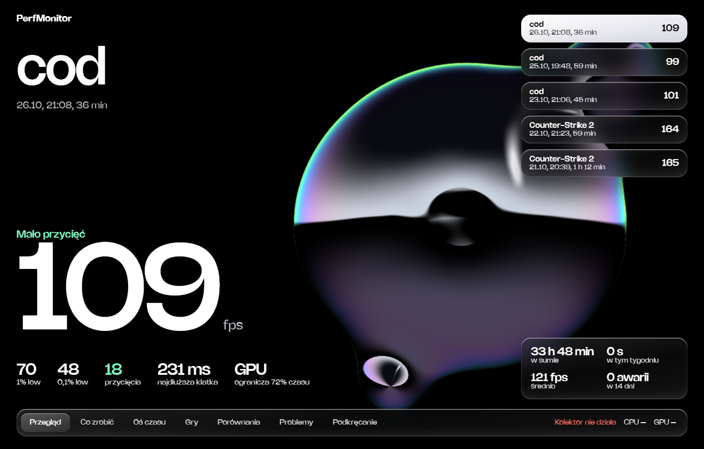
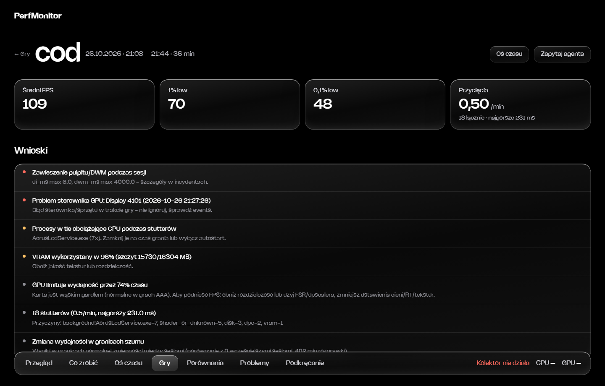
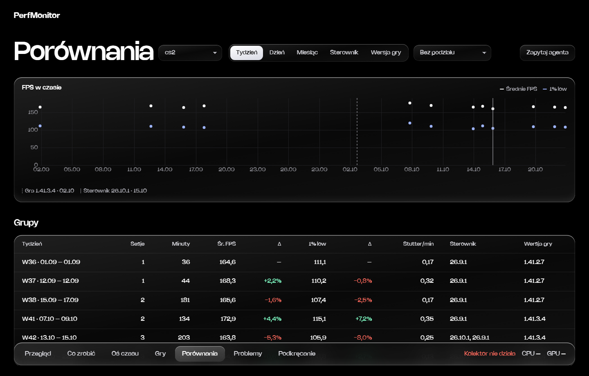
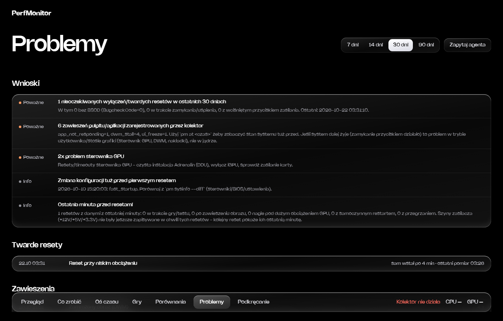

# PerfMonitor

A Windows 11 black box for gamers: it records how your PC performs while you play, then tells you what caused the stutters, freezes, crashes and hard resets, and what changed since the game last ran well.

The interface is in Polish.



<p>
  
  
</p>
<p>
  
</p>

The screenshots show synthetic demo data.

## Features

- **Background collector.** An elevated scheduled task started at logon samples CPU and GPU load, clocks, power and temperatures once per second (LibreHardwareMonitor), plus RAM, disk, network, the foreground app and desktop responsiveness. Frame times come from Intel PresentMon.
- **Game sessions.** Games are detected by executable name and install path. Each session gets average FPS, 1% and 0.1% lows, stutter counts and the worst frame. Menus and loading screens are left out of gameplay statistics, and frame generation is accounted for separately from application frames.
- **Stutter causes.** A condition is reported as a cause only when it shows up around stutters more often than in normal seconds: background processes, shader compilation, disk, DPC load, VRAM exhaustion, CPU or GPU bottleneck.
- **Freezes, crashes and hard resets.** Desktop and DWM freezes, application crashes (WER), GPU driver timeouts, blue screens, and unexpected shutdowns. For a hard reset it keeps the last minute before it, including the PSU rails the motherboard reports.
- **ETW black box.** A kernel trace is kept in a circular memory buffer and written to disk when something goes wrong (a freeze, a DPC storm, a stutter burst, or your own mark). The top offending drivers and disk I/O are extracted afterwards. Press `Ctrl+Alt+L` while playing to mark a lag.
- **What changed.** Compares a session with your earlier sessions of the same game and ignores differences within normal noise. A readable diff of GPU driver, Windows and game build, game settings and system snapshots explains regressions.
- **Advice.** A short ranked list of concrete changes, each backed by your own numbers. An item disappears once the condition is gone. Settings PerfMonitor cannot read are listed as manual checks. `pm test` verifies a single change with a before/after verdict.
- **Network quality.** Ping, packet loss, DNS time and Wi-Fi link quality, with each incident placed at home, ISP or internet.
- **Undervolt and overclock.** UV/OC profiles, stress tests and idle soaks, WHEA error attribution, per-core stability, and a single suggested next step. PerfMonitor only reads: it never changes a BIOS, Adrenalin or registry setting.
- **CLI.** `pm` exposes the same data: `pm status`, `pm advise`, `pm sessions`, `pm session <id>`, `pm compare`, `pm health`, `pm incidents`, `pm net`, `pm oc`, `pm sql` and more (`pm --help`).

The window has seven pages: Przegląd (overview), Co zrobić (advice), Oś czasu (timeline), Gry (games), Porównania (compare), Problemy (problems) and Podkręcanie (overclocking). The "Zapytaj agenta" buttons copy a ready-made prompt for an AI coding agent that can read the database.

## Requirements

- Windows 10 or 11, x64
- Administrator rights (the collector reads kernel counters and runs ETW traces)
- A GPU from AMD, NVIDIA or Intel. Load, clocks, temperatures and frame times work on all of them through LibreHardwareMonitor and PresentMon. PerfMonitor was tuned on a Ryzen 7000 CPU with a Radeon GPU, and some overclocking features are AMD-specific: the GPU tuning readout (Adrenalin, via ADL), the Adrenalin global 3D settings, and the Zen 4 error mapping. Elsewhere those parts stay empty.

## Install

1. Download `PerfMonitor-Setup-<version>.exe` from [Releases](https://github.com/noyex/PerfMonitor/releases).
2. Run it. The installer is not code-signed, so SmartScreen shows "Windows protected your PC": click **More info**, then **Run anyway**.
3. Accept the UAC prompt. Optionally let it install LibreHardwareMonitor and PresentMon through winget.

The installer copies the app to Program Files, registers the "PerfMonitor Collector" task that starts at logon, and adds Start Menu and (optionally) desktop shortcuts. Your data lives in `%LOCALAPPDATA%\PerfMonitor`.

Without LibreHardwareMonitor and PresentMon the collector still runs, but temperatures, clocks and frame data are missing.

## Updates

The app checks GitHub Releases. When a newer version exists, an **Aktualizuj do X** button appears in the bottom dock. It downloads the installer, verifies its SHA-256 against the release's `SHA256SUMS.txt`, and installs silently after one UAC prompt. The app then restarts. Your data is not touched.

## Privacy

Everything stays on your machine, in a SQLite database under `%LOCALAPPDATA%\PerfMonitor`. There is no account, telemetry or upload. The UI server listens on `127.0.0.1` only. The only network traffic:

- **Update check:** a request to `api.github.com` every few hours, and the installer download from GitHub when you click update.
- **Network monitor:** ICMP pings to your router, the first hop beyond it, `1.1.1.1` and `8.8.8.8` (change them with `net_targets` in `config.json`), and to the game server's address while a game is running. It also resolves a random, non-existent name through your system DNS resolver to time it.

PerfMonitor records process names, Windows event log entries and hardware readings. It does not read game memory, with one opt-in exception: `game_modules` (off by default) lists the DLLs loaded in the game process, which some kernel anti-cheats may log.

## Uninstall

Windows Settings, Apps, Installed apps, PerfMonitor. This removes the program and the logon task. Your data in `%LOCALAPPDATA%\PerfMonitor` stays: delete the folder if you want it gone.

## Development

```powershell
py -3.13 -m venv .venv
.venv\Scripts\pip install -r requirements.txt
install.cmd        # registers the logon task from this checkout (data in .\data)
pm.cmd status      # the CLI
python -m unittest discover -s tests -t .
```

Settings can be overridden in `config.json` in the data folder (see `perfmon/config.py` for the defaults, including the list of detected games).

## Building and releasing

```powershell
pip install -r requirements-build.txt
python packaging/version_info.py
pyinstaller packaging/perfmon.spec --noconfirm
iscc /DAppVersion=x.y.z packaging\PerfMonitor.iss     # -> dist\PerfMonitor-Setup-x.y.z.exe
```

Inno Setup 6 is required for the last step. To release, bump `__version__` in `perfmon/__init__.py` and push a tag `vX.Y.Z`. `.github/workflows/release.yml` runs the tests, builds the installer and publishes the release with `SHA256SUMS.txt`.

## Contributing

See [CONTRIBUTING.md](CONTRIBUTING.md).

## License

[MIT](LICENSE)
